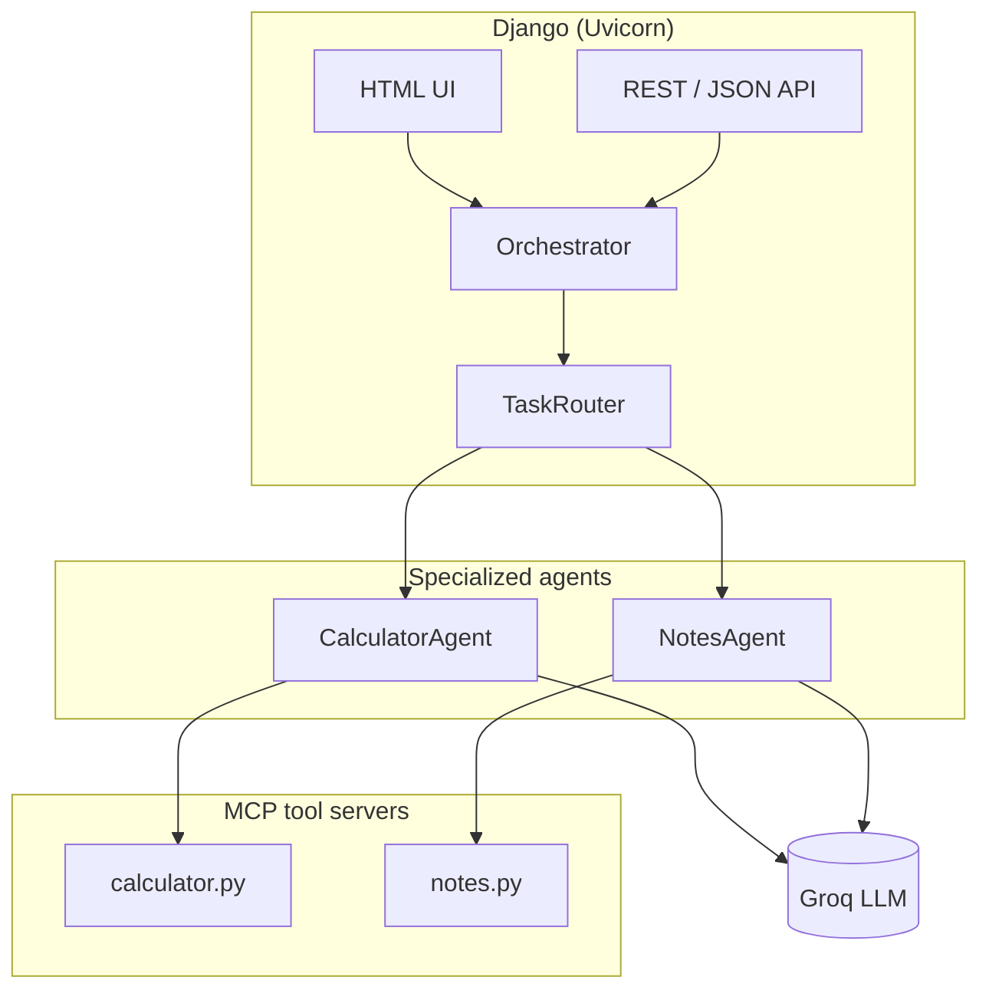

# AI Agent Lab

> A Django teaching lab that wires **LLM agents**, **MCP tool servers**, and **Agent-to-Agent (A2A)** delegation into one runnable application.

[](https://www.djangoproject.com/)
[](https://www.python.org/)
[](https://modelcontextprotocol.io/)
[](https://console.groq.com/)

---

## Overview

**AI Agent Lab** demonstrates how modern agentic systems are composed in practice:

| Layer | Role |
|-------|------|
| **Django + Uvicorn** | Web UI, REST API, persistence, and orchestration entry point |
| **Groq LLM** | Natural-language reasoning and tool selection |
| **MCP servers** | Standalone tool providers (calculator, notes) over the Model Context Protocol |
| **A2A layer** | Agent cards, task routing, and delegation between specialized agents |

Students and developers can explore calculator math, note-taking workflows, multi-agent chat, and A2A delegation—all from a browser or JSON API.

---

## Features

- **Calculator agent** — arithmetic, algebra (`sympy`), statistics (`numpy`), unit conversion (`pint`), and matrix ops via MCP tools
- **Notes agent** — create, search, and manage notes through MCP-backed tools
- **Orchestrator** — lazy bootstrap, routes messages to the right agent, degrades gracefully when `GROQ_API_KEY` is missing
- **A2A demo** — task delegation, agent registry, and `/.well-known/agent.json` agent cards
- **Web UI** — dashboard, calculator, agent chat, notes, history, and A2A playground
- **Docker-ready** — single-service `docker compose` setup with health checks and persistent SQLite volume
- **Test suite** — `pytest` coverage for MCP tools, agents, views, and A2A flows

---

## Architecture



**Request flow (simplified):**

1. User sends a message from the UI or API.
2. The **Orchestrator** picks an agent (or uses a hint).
3. The agent calls **Groq** and invokes **MCP tools** as needed.
4. Results are stored and returned to the client.

---

## Project structure

```
ai-agent-lab/
├── ai_agent_lab/          # Django project settings & URLs
├── mcp_engine/            # Main application
│   ├── agents/            # CalculatorAgent, NotesAgent, Orchestrator
│   ├── a2a/               # Registry, router, message schemas
│   ├── llm/               # Groq provider abstraction
│   ├── mcp_servers/       # Standalone MCP tool servers
│   ├── templates/         # Web UI pages
│   └── tests/             # Pytest suite
├── docs/                  # Lab guide (LaTeX source)
├── docker-compose.yml
├── Dockerfile
├── requirements.txt
└── .env.example           # Copy to .env — never commit secrets
```

---

## Quick start

### Prerequisites

- Python **3.12+** (Django 6 requires it)
- A free [Groq API key](https://console.groq.com) (optional for UI exploration; required for agent chat)

### Local development

```bash
# 1. Clone and enter the project
git clone https://github.com/ChaoukiBayoudhi/ai-agent-lab.git
cd ai-agent-lab

# 2. Create a virtual environment
python -m venv myenv
source myenv/bin/activate   # Windows: myenv\Scripts\activate

# 3. Install dependencies
pip install -r requirements.txt

# 4. Configure environment
cp .env.example .env
# Edit .env — set GROQ_API_KEY and DJANGO_SECRET_KEY

# 5. Migrate and run
python manage.py migrate
python manage.py runserver
```

Open **http://127.0.0.1:8000/** for the dashboard.

### Docker

```bash
cp .env.example .env          # fill in GROQ_API_KEY
docker compose up --build     # first run
docker compose up -d          # detached
docker compose logs -f web    # tail logs
```

The app is served at **http://localhost:8000/**.

---

## Environment variables

| Variable | Description |
|----------|-------------|
| `DJANGO_SECRET_KEY` | Django secret (use a long random string in production) |
| `DJANGO_DEBUG` | `True` for development |
| `DJANGO_ALLOWED_HOSTS` | Comma-separated hosts |
| `GROQ_API_KEY` | Groq API key for LLM-backed agents |
| `GROQ_MODEL` | Model id (default: `llama-3.3-70b-versatile`) |
| `CALCULATOR_MCP_HOST` / `PORT` | Calculator MCP server endpoint |
| `NOTES_MCP_HOST` / `PORT` | Notes MCP server endpoint |

See [`.env.example`](.env.example) for the full list.

---

## Web routes & API

| Path | Description |
|------|-------------|
| `/` | Dashboard |
| `/calculator/` | Calculator UI |
| `/agent/` | Agent chat |
| `/a2a/` | A2A delegation demo |
| `/notes/` | Notes UI |
| `/history/` | Interaction history |
| `/api/calculate/` | Direct calculator API |
| `/api/agent/chat/` | Agent chat API |
| `/api/a2a/delegate/` | A2A task delegation |
| `/api/agents/` | List registered agents |
| `/.well-known/agent.json` | Agent card (A2A discovery) |

---

## MCP tool servers

Run MCP servers standalone for debugging or stdio/SSE transport experiments:

```bash
# Calculator (stdio default)
python -m mcp_engine.mcp_servers.calculator

# Calculator over SSE on port 8001
python -m mcp_engine.mcp_servers.calculator --port 8001 --transport sse

# Notes server
python -m mcp_engine.mcp_servers.notes
```

**Calculator tools:** `calculate`, `solve_equation`, `metrics`, `unit_convert`, `matrix_ops`  
Expressions are parsed with **SymPy** — never `eval()`.

---

## Testing

```bash
pytest
# or with verbose output
pytest -v
```

Tests cover MCP calculators/notes, agent logic, Django views, and A2A routing.

---

## Tech stack

- [Django](https://www.djangoproject.com/) 6 · [Django REST Framework](https://www.django-rest-framework.org/)
- [Uvicorn](https://www.uvicorn.org/) (ASGI)
- [MCP Python SDK](https://github.com/modelcontextprotocol/python-sdk)
- [Groq](https://groq.com/) · [SymPy](https://www.sympy.org/) · [NumPy](https://numpy.org/) · [Pint](https://pint.readthedocs.io/)
- [pytest](https://docs.pytest.org/) · [pytest-django](https://pytest-django.readthedocs.io/)

---

## Documentation

The full lab guide (PDF) is built from `docs/lab_guide.tex`. See the `docs/` folder for the LaTeX source.

---

## License & context

Built as a **Sesame / Django programming lab** (2025–2026) for teaching MCP, agents, and A2A patterns. Use and adapt freely for educational purposes.

---

<p align="center">
  <sub>Questions or improvements? Open an issue or submit a pull request.</sub>
</p>
